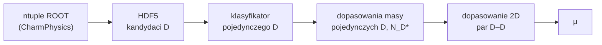

# charmtag

Pomiar par mezonów powabnych (D⁰D⁰, D⁺D⁰, D⁺D⁺) w zderzeniach pp minimum bias w ATLAS (13,6 TeV, 2022): klasyfikator pojedynczego D,
dopasowanie masy, pary D–D z dopasowaniem 2D i stosunek μ = [N_par / N_D*]_dane / [N_par / N_D*]_Pythia.

Dane wejściowe to tabele kandydatów na mezony D (ntuple) wytworzone kodem grupy
[CharmPhysics](https://gitlab.cern.ch/berkeleylab/CharmPhysics) i zapisane w formacie HDF5 ([docs/data_format.md](docs/data_format.md)):
dane ATLAS z runów 427929 i 428770 oraz symulacja (Pythia 8). Na tych plikach policzono wyniki opisane w `results/`.
Pliki są duże i wewnętrzne, więc leżą na dyskach CERN (EOS), a nie w tym repozytorium.


## Pierwsze kroki
Sklonuj repozytorium:
```
git clone https://github.com/333963/charmtag.git
cd charmtag
```

Utwórz środowisko (Python 3.10 lub nowszy) i zainstaluj pakiet; zależność `charmbkg` pochodzi z repo
[charmbkg](https://github.com/333963/charmbkg):
```
python3 -m venv .venv
source .venv/bin/activate
pip install -e ".[dev]"
```

Sprawdź, że wszystko działa:
```
pytest -q -m "not slow"
```

Testy trwają 10–15 minut i nie wymagają dostępu do plików na EOS.

Odtwórz wynik główny (dopasowanie końcowe z wejść zapisanych w repozytorium, kilka minut):
```
python analysis/_odtworzenie/odtworz_wynik_glowny.py
```

Analizy na danych liczono na lxplus (HTCondor, [docs/running_on_lxplus.md](docs/running_on_lxplus.md)); wymagają dostępu do plików na EOS.
Opis odtwarzania i wersji kodu: [PRZEGLAD.md](PRZEGLAD.md#jak-odtworzyć-wynik-główny).

Polecenia pakietu:
 - `charmtag all -c <konfiguracja> --species D0|Dplus` — klasyfikator i dopasowanie masy pojedynczych D (wzór konfiguracji: `configs/examples/mac_v11.yaml`)
 - `charmtag pairs -c <konfiguracja>` i `charmtag fit2d -c <konfiguracja> [--ntoys N]` — pary D–D i dopasowanie 2D; bez `--unblind` centrum płaszczyzny mas par pozostaje zakryte
 - `odtworz_wynik_glowny.py --what nom428` odtwarza dopasowanie runu 428770, a `--charmtag repo` liczy je bieżącym pakietem zamiast kodu zamrożonego

## Struktura
 - `charmtag/` — pakiet i CLI `charmtag`: klasyfikator, dopasowanie masy, N_D*, pary D–D (`pairs/`), systematyki (`syst/`).
 - `tests/` — testy pytest; testy projektu B są pomijane, gdy brak `charmbkg`.
 - `analysis/` — skrypty, które policzyły wyniki (zadania lxplus, raporty, budżety), zamrożony kod dopasowania końcowego i narzędzia odtworzenia.
 - `results/` — raporty, tabele i JSON z liczbami, nota wynikowa i prezentacja; spis: [results/README.md](results/README.md).
 - `docs/` — opis metody, format danych, uruchamianie na lxplus i historia projektu.
 - `configs/examples/`, `examples/` — przykładowe konfiguracje i przykład na zestawie testowym.
 - `scripts/studies/`, `inputs/` — starsze skrypty pomocnicze i jeden plik wejściowy.



## Wyniki w skrócie
 - Wynik główny, run 427929 (czysty minimum bias): μ = 0,50 +0,41/−0,37 (stat) +0,28/−0,19 (syst) ± 0,21 (N_D*), Z = 1,60.
 - Run 428770 (obciążony triggerem dżetowym, pomiar pomocniczy): μ = 1,27 +0,41/−0,40 (stat) ± 0,36 (syst) ± 0,28 (N_D*), Z = 4,05.

Pełny przegląd (interpretacja, znane problemy, wersje kodu, mapa repo): [PRZEGLAD.md](PRZEGLAD.md).

Projekt bliźniaczy (tło i pomiary pojedynczych D): [charmbkg](https://github.com/333963/charmbkg).
