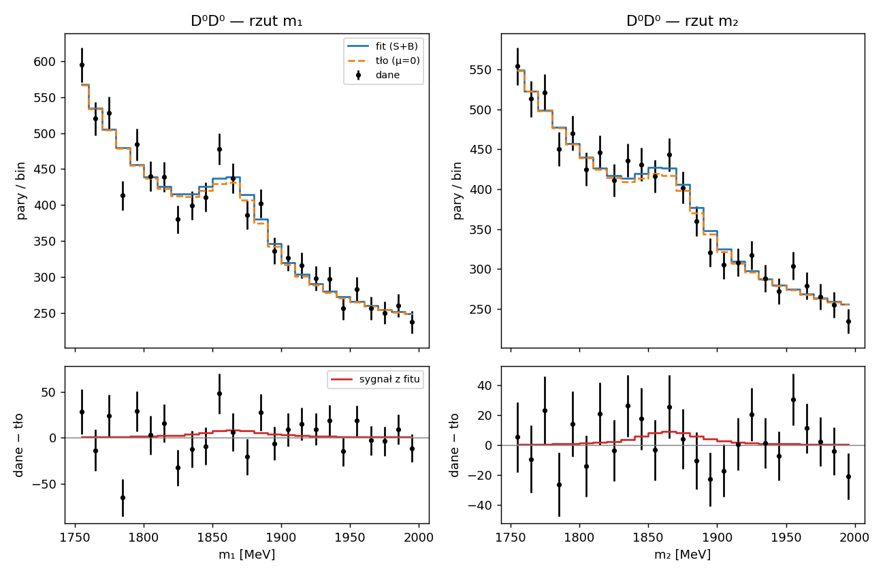
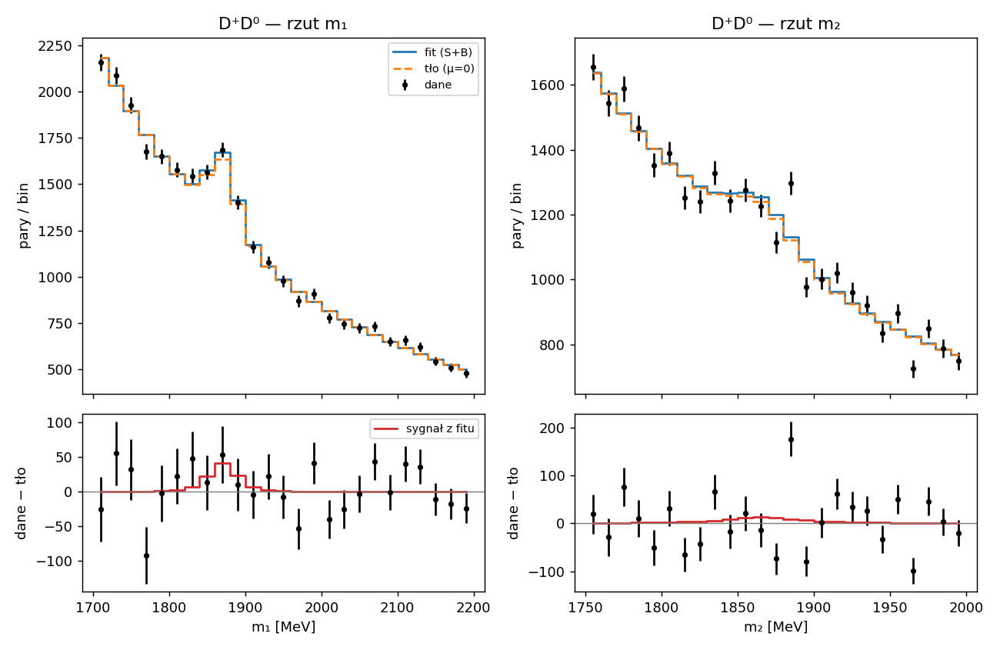
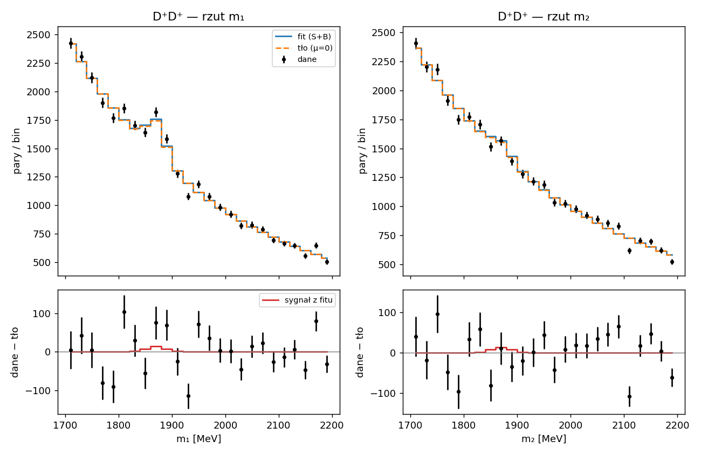

# Pary D–D (D⁰D⁰, D⁺D⁰, D⁺D⁺) — wynik po odsłonięciu, pełna lumi 2022 (run 428770), weto śladów d0z0

Wynik odsłonięty (decyzja: flaga UNBLIND_OK, bramki T-PREP).
Wygenerowano 2026-11-05 19:36 UTC · wyniki `../PF2_lxplus/runs/lxplus/unblind` · ślepy bieg `../PF2_lxplus/runs/lxplus` · normalizacja `direct` · N_D* (dane) = 5584 (massfit.fit_dm (fallback); stary `fit_dm`: —).

## 0. Zapis od 19.11 — wynik główny 427929 (decyzja)

Decyzja z 19.11.2026 (~19:15): wynik główny = run **427929** (czysty minimum bias, HLT_mb_mbts_L1MBTS_1), normalizacja z prawdy Pythii mb_nd.

**μ(427929) = 0,50 +0,41/−0,37 (stat, × 1,13 jackknife) +0,28/−0,19 (syst) ± 0,21 (N_D*)**; Z = 1,60 (≈ 1,4 z korelacjami zdarzeń); względem Pythii (μ = 1) −0,9σ (skale w μ̂), −0,6σ (skale w μ = 1) → zgodne z Pythią.
- Syst asymetryczny: górna strona wiersza tune Pythii = fragmentacja ALICE (δ ≈ −29 % par/D*, zastępuje górną stronę CRqcd −11 %; `frag/FRAG.md`); względnie +0,551/−0,374.
- N_D* = 2046 ± 485 ± 677 (41 %, `r427929/nds/NDS_427929.md`); szerokość piku D* (`r427929/ndsw/NDSW.md`) nierozstrzygnięta wg kryterium → nominał 0,50; dane przy wysokim pT wskazują wariant μ ≈ 0,72.
- Warianty interpretacji (nie nominał): szerokość z MC 0,72; fragmentacja ALICE μ/0,71 = 0,70; oba ≈ 1,0.
- σ_eff > ~6 mb (95 % CL, f_DPS = 0,40; rozpiętość 4–11 mb) — `r427929/SIGMA_EFF.md`.
- **428770 (sekcje 1–7 poniżej: 1,50 direct / 1,27 prawda mb_nd) jest odtąd obserwacją obciążoną triggerem J12** (UBTRIG +3,7σ J12only vs reszta; test zerowy 24 ziarna: J12 Z = 3,25, J12 − reszta Z ≈ 8; topologia kolinearna λ̂ = −1,11) — nie pomiarem μ w minimum bias.

Źródła: `truthnorm/TRUTHNORM.md`, `r427929/BUDZET_427929.md` (+ `budzet_427929.json`), `ubtrig/UBTRIG.md`, `ubtrig/null/UBTRIG_NULL.md`, `charm_work/NOTA_WYNIK/nota.md` §7–8.

## 1. Wynik
| kanał | μ̂ (dane/Pythia) | 68 % (profil) | σ_stat (Hesse) | σ_syst (U) | Z obs | Z oczek. (ślepy Asimov) | p lok. | dev/ndf | S oczek. (pełna płaszczyzna) |
|---|---|---|---|---|---|---|---|---|---|
| D⁰D⁰ | 1.16 | [0.64, 1.72] | ± 0.55 | ± 0.32 | 2.25 | 1.90 | 0.0123 | 0.69 | 58.1 |
| D⁺D⁰ | 1.16 | [0.75, 1.58] | ± 0.42 | ± 0.27 | 3.01 | 2.71 | 0.0013 | 0.96 | 90.4 |
| D⁺D⁺ | 1.39 | [0.49, 2.33] | ± 0.93 | ± 0.37 | 1.57 | 1.10 | 0.0580 | 1.07 | 25.8 |

**Wspólne μ = 1.25 [0.90, 1.51], Z = 4.06σ (p = 0.00002)**; oczekiwane (ślepo, Asimov) 3.49σ.
Z systematykami kształtu profilowanymi: μ = 1.25, Z = 4.11σ. Wspólna systematyka μ (U, total_common): ±0.28.
- więz κ partnera σ=0.3: wspólne μ = 1.00, Z = 3.42σ
- więz κ partnera σ=0.5: wspólne μ = 1.00, Z = 3.13σ

### 1b. Korekta normalizacji N_D* (NDS, post hoc)
N_D* użyte w fit2d: 5584 (massfit.fit_dm (fallback)); NDS: 4443 ± 612 (stat) ± 591 (syst) → k = N_użyte/N_NDS = 1.257, względny błąd N_D* 19.1 %. Z nie zależy od N_D*. Źródło: ndstar_full.json (NDS).
| kanał | μ̂ (fit2d) | μ̂ × k | 68 % × k ± σ_stat × k | ± σ(N_D*) | Z (bez zmian) |
|---|---|---|---|---|---|
| D⁰D⁰ | 1.16 | 1.46 | [0.80, 2.16] ± 0.69 | ± 0.28 (⊕ = ± 0.75) | 2.25 |
| D⁺D⁰ | 1.16 | 1.46 | [0.95, 1.99] ± 0.53 | ± 0.28 (⊕ = ± 0.60) | 3.01 |
| D⁺D⁺ | 1.39 | 1.74 | [0.61, 2.93] ± 1.16 | ± 0.33 (⊕ = ± 1.21) | 1.57 |
**Wspólne μ po korekcie N_D*: 1.57 ± 0.38 (stat) ± 0.30 (N_D*).**

> **Aktualizacja 2026-11-09 (etap ndstar, `PD_pairs_diff/ndstar/ndstar.md`) — zastępuje wiersz powyżej:** wspólne μ = 1.25 z fit2d jest minimum
> skwantowanym do siatki profilu 0.25 (`fit2d.combine`, interpolacja liniowa); gładkie minimum sumy profili = 1.19 [0.88, 1.51] (baza 5584).
> Syst N_D* rozszerzona o źródło kształtu MC (±339 → δN/N 20.6 %). **Wspólne μ (N_D* = 4443) = 1.49 +0.41/−0.39 (stat) ± 0.31 (N_D*)**; Z bez zmian (4.06σ / 4.11σ).
> μ per kanał (tabela wyżej) bez zmian.

> **Aktualizacja 2026-11-12 (tune Pythii + budżet systematyk, `TUNE_pythia/budget_with_tune.md`):** zapis wyniku (zatwierdzony 12.11; **obowiązywał do 12.11** — błąd stat. zastąpiony 13.11, zob. niżej):
> **μ_wsp. = 1,50 +0,41/−0,39 (stat) ± 0,42 (syst) ± 0,33 (N_D*)**; Z = 4,06σ (4,11σ z syst. prof.) bez zmian.
> Baza N_D* zmieniona 12.11 z 4443 (20,6 %) na 4436 (21,9 %) po poprawce NLL w `fit_single` (`NDS_ndstar/rerun_2026-11-12/rerun.md`); poprzedni zapis tego dnia: 1,49 +0,41/−0,39 (stat) ± 0,42 (syst) ± 0,31 (N_D*).
> Rozbicie (μ_wsp. = 1,495): tune Pythii w całości (MPI ⊕ CR z CRqcd ⊕ Monash, wspólne względne 0,040 / 0,108 / 0,019 → 0,117) = ± 0,17;
> syst. łączna bez wiersza N_D* z fitu fallback (0,105, zastąpiony przez N_D* = 4436, 21,9 %), z tune: względnie 0,284 → ± 0,42 (bez tune 0,258 → ± 0,39);
> N_D* ± 0,33. Tune jest symetryzowany (|δ|); ścisła asymetria (CRqcd przesuwa μ tylko w górę): +0,43/−0,40.
> „± 0.28” w §1 i wartości w §4 to wielkości WZGLĘDNE (Δμ przy μ = 1 z tabeli ślepej), nie bezwzględne; nowy zapis podaje systematykę w skali μ = 1,50 i bez podwójnego liczenia N_D*.
> Ten zapis zastępuje „Wspólna systematyka μ (U, total_common): ±0.28” z §1 jako podsumowanie systematyki (linia w §1 pozostaje jako zapis historyczny).

> **Aktualizacja 2026-11-13 (jackknife na danych, decyzja z 13.11) — zastępuje błąd stat. w zapisie 12.11:**
> **μ_wsp. = 1,50 +0,48/−0,46 (stat, × 1,18 z jackknife po zdarzeniach) ± 0,42 (syst) ± 0,33 (N_D*)**
> (do 12.11: stat +0,41/−0,39 = sam profil; 0,41 × 1,18 = 0,48, 0,39 × 1,18 = 0,46).
> Istotność nominalna (preregistrowana) **Z = 4,06σ (4,11σ z syst. prof.) bez zmian**; obok: z korelacjami zdarzeń ≈ 3,4σ (4,06 / 1,18; zakres 3,3–3,6
> z niepewności czynnika; przeskalowanie, nie przeliczony fit).
> Uzasadnienie: preregistracja (`T_PREP/unblinding_checklist.md` §2) — `mu_err` raportowany jako max(Hesse·infl., profil), inflacja z pomiaru
> po zdarzeniach. Jackknife po 200 grupach zdarzeń (hash(run, event) mod 200; precyzja ±5 %): σ_jk/σ wspólne 1,18 ± 0,06 (kanały 1,12 / 1,10 / 1,21).
> Wspólne > kanały, bo to samo zdarzenie dokłada pary do D⁰D⁰ i D⁺D⁰ (korelacja z jackknife +0,16), a fit traktuje kanały jako niezależne.
> Bieg po 39 plikach (±11 %) daje 1,00 ± 0,11; biegi różnią się o ~1,5σ — przyjęty bieg po zdarzeniach (dokładniejszy, wprost mierzy korelacje
> w zdarzeniu). Szczegóły i weryfikacje: §7 (tabela jackknife). Model, konfiguracja, kategorie, μ̂, syst. ± 0,42 i N_D* ± 0,33 bez zmian;
> nagłówki per kanał (§1, 1b) nieprzeliczone — czynniki per kanał w §7.

> **Aktualizacja 2026-11-16 (zapis PRZEJŚCIOWY, decyzja z 16.11) — budżet syst. po niezależnej weryfikacji
> (`charm_work/VER_budget/RAPORT.md`):**
> **μ_wsp. = 1,50 +0,48/−0,46 (stat) ± 0,61 (syst) ± 0,33 (N_D*)**; μ̂ i Z = 4,06σ (≈3,4σ z korelacjami) bez zmian.
> Zmiany w syst. (było ± 0,42): (1) stat. MC par liczona z n_eff wag 2D (n_eff 8,2 / 13,5 / 7,5) zamiast 1/√n (21 / 41 / 15) →
> wspólne 0,188 → 0,308, w μ ±0,46; (2) nowy wiersz modelu wag zdarzeń (w2 ↔ w1, proxy z pojedynczych D) ±0,24;
> (3) nowy wiersz κ_cls (korelacja ε klasyfikatora między nogami, MC 1,03–1,06, mechanizm niewyjaśniony) ±0,06 (jednostronnie w dół);
> tune ±0,17 bez zmian. Transfer D⁺ przez Pythię (FR_ratios) — odrzucony jako osobny wiersz (pokryty przez N_D* i model wag).
> Przejściowy, bo stat. MC i model wag mają zejść po normalizacji z prawdy A3 (5·10⁸) — pakiet `Q_lxplus/gen_norm`,
> procedura z bramkami B1–B7: `charm_work/GEN_mcstat/PROCEDURA.md` (oczekiwane syst. normalizacji ~±0,15–0,27).
> Kod: `charmtag.pairs.build.mc_pair_rel_stat` (charmtag, 16.11; `pairs.mc_pairs_neff`). Poprzednia wersja pliku: `UNB_WYNIK.md.przed_2026-11-16`.

## 2. Kontrole stabilności
| kanał | bias toys @fit | μ po korekcie biasu | σ(pull) | pokrycie 68 % | μ bez kategorii z tagiem D* | κ=channel: μ (Z) |
|---|---|---|---|---|---|---|
| D⁰D⁰ | 0.012 | 1.15 | 0.81 | 0.80 | 1.32 ± 0.76 | 1.17 (2.28) |
| D⁺D⁰ | 0.094 | 1.07 | 0.99 | 0.66 | 0.94 ± 0.53 | 1.08 (2.79) |
| D⁺D⁺ | -0.113 | 1.50 | 1.04 | 0.64 | 1.39 ± 0.93 | 1.37 (1.55) |

## 3. Rzuty m₁, m₂ (suma po kategoriach score) — dane vs fit

(dodane 10.11; wykresy z `fill_unblind.py` na `pairs/pairs_full.npz` + `pair_inputs.npz`, nominalny fit planB)

## 4. Budżet systematyk μ (U, po PF)
| kanał | σ_stat | kształty | SF | normalizacja | κ, kategorie | suma syst | μ (syst prof.) | Z (syst prof.) |
|---|---|---|---|---|---|---|---|---|
| D⁰D⁰ | 0.57 | 0.09 | 0.18 | 0.24 | 0.07 | 0.32 | 1.13 | 2.16 |
| D⁺D⁰ | 0.41 | 0.08 | 0.13 | 0.19 | 0.12 | 0.27 | 1.21 | 3.10 |
| D⁺D⁺ | 0.90 | 0.09 | 0.20 | 0.28 | 0.08 | 0.37 | 1.44 | 1.64 |
- Y (model tła D⁺ exp vs pol2, poziom pojedynczego D): plik `syst_bkg_model_Dplus.json` — wchodzi przez U jako „bkg_poly3”/kształty; tu informacyjnie.
- S8/B4 SALAD vs SB (ε_B pod pikiem, D⁺, WP70): max |Δ| = 0.64 — systematyka ε_B pojedynczego D (B4 → U).
- **Aktualizacja 12.11** (`TUNE_pythia/budget_with_tune.md`): suma systematyk z tune Pythii, bez wiersza N_D* (względnie):
  D⁰D⁰ 0,325, D⁺D⁰ 0,279, D⁺D⁺ 0,366 (przed: 0,301 / 0,253 / 0,351); wspólne 0,284 (× 1,495 = ± 0,42; baza N_D* = 4436). Tabela powyżej to wartości
  względne (Δμ przy μ = 1) sprzed tune, z wierszem N_D* z fitu fallback.

## 5. Porównanie z wrześniem (v1.0, 27.09: 3,6σ, stare weto śladów — nieskuteczne dla D⁺)
| kanał | pary oczek. (Pythia, pełna płaszczyzna) | wrzesień μ / Z | teraz μ / Z |
|---|---|---|---|
| D⁰D⁰ | 125.7 | 1.37 / 1.9 | 1.16 / 2.25 |
| D⁺D⁰ | 204.7 | 1.62 / 2.9 | 1.16 / 3.01 |
| D⁺D⁺ | 61.2 | 1.57 / 1.0 | 1.39 / 1.57 |
Wrzesień łącznie: μ = 1.50, Z = 3.6σ → teraz μ = 1.25, Z = 4.06σ.

## 6. Uwagi
- Ślepy bieg `pf_pairs` i węzeł `unblind` (src 2.0.2 z poprawką ID śladu z 5.11) liczą N_D* `dstar_refit.fit_single`, który na pełnej lumi nie zbiegał (valid=False) → fallback `fit_dm` (σ≤2,5 MeV, sztywne tło: N zawyżone). NDS naprawił fit (tło próg×pol2, kwadratura GL) → korekta post hoc w 1b; μ ∝ 1/N_D*, Z nie zależy od N_D*.
- Toys przy μ̂ (100/kanał), kontrola bez tagu D* i κ=channel to część węzła `fit2d --unblind` (bez zmian konfiguracji po decyzji; hash cfg w UNBLIND_OK).

## 7. Kontrole post hoc (09–13.11.2026) — NIE zmieniają μ̂ ani Z nominalnego (jackknife 13.11 poszerza błąd stat., wg §2 preregistracji)
Zgodnie z preregistracją (`T_PREP/unblinding_checklist.md` §2) po odsłonięciu model, konfiguracja i kategorie pozostają bez zmian.
Poniższe to kontrole wykonane po odsłonięciu; nominalny wynik to nadal **Z = 4,06σ (4,11σ z syst. prof.)**, μ jak w 1b (od 13.11 stat +0,48/−0,46 z inflacją jackknife).

| kontrola | wynik | wpływ | źródło |
|---|---|---|---|
| Plasterki D⁺D⁰ (4 ± 14 / 8 ± 13 par vs „~46”) | rzut modelu przez tę samą procedurę daje ~17 par/panel; separacja H1/H0 ~1,1σ | test bez mocy, nie podważa modelu | `UNB_DRY/charm-UNB-WYNIK_slice_model.md` |
| Nadmiar niskiej m(D⁰) przy D⁺ w piku (1750–1840 MeV) | +51 ± 18 par (~2,7σ lokalnie) | patrz wiersze niżej | j.w. |
| Cięcie m(D⁰) > 1790 MeV (D⁺D⁰) | μ̂ 1,165 → 0,984; Z_wsp. 4,06 → 3,69 | odrzucone jako poprawka (usuwa dane, nie wyjaśnia) | j.w. |
| Weto Ds→φπ na nodze D⁺ | już nałożone w ntuplach (dziura m(KK) 1008–1031 MeV w danych i MC) | Δμ̂ = 0 | `DS_veto/ds_veto.md` |
| Udział swapów D⁰ dane vs MC (tag D*) | swap/okno: dane 1,02 ± 0,06, MC mb 1,01, fd 0,90 | ~1–3 pary z 51; nie wyjaśnia nadmiaru | `SWAP_d0/swap_d0.md` §2 |
| c-matched (truth 2–7) przy prawdziwym D⁺, MC par z prawdą | 0,58 ± 0,28 na sygnał w oknie po niskiej stronie (pojedyncze nogi: 0,57) | ~10–14 par z 51; reszta ~2σ | `SWAP_d0/swap_d0.md` §3, §5 |
| Refit z c-matched w S nogi D⁰ (r × 0,5–1,5) | μ_wsp. (baza 5584) 1,19 → 1,15–1,21; Z_wsp. 4,07 → 4,31–4,60; dev/ndf bez zmian | **syst. kształtu nogi D⁰: Δμ_wsp. ± 0,04** (× 1,259 przy N_D* = 4436: ± 0,05) | `SWAP_d0/swap_d0.md` §6 |

- Systematyka ±0,04 (±0,05 po korekcie N_D*) jest mała wobec ±0,28 (U) i ±0,31 (N_D*; od 12.11 ±0,33 przy N_D* = 4436); dopisana tu, nie w profilu.
- Wariant c-matched zwiększa Z, bo niemodelowana składowa skorelowana z D⁺ staje się częścią sygnału. Norma r pochodzi z MC (±50 %),
  a dane jej nie rozróżniają, więc wariant jest kontrolą, nie nominałem.
- **Toys przy μ̂, 1000/kanał (10.11, lokalnie, ta sama procedura co węzeł `fit2d --unblind`; `UNB_DRY/toys_at_fit/toys_at_fit.md`):**

  | kanał | bias μ | σ(pull) | pokrycie 68 % (profil) | Z med [16–84 %] | Z obs | p(Z_toy ≥ Z_obs) |
  |---|---|---|---|---|---|---|
  | D⁰D⁰ | −0,058 ± 0,018 | 1,03 ± 0,02 | 0,681 ± 0,015 | 2,08 [1,05–3,11] | 2,25 | 0,44 |
  | D⁺D⁰ | +0,058 ± 0,013 | 0,99 ± 0,02 | 0,686 ± 0,015 | 3,09 [2,06–4,11] | 3,01 | 0,53 |
  | D⁺D⁺ | −0,105 ± 0,028 | 1,01 ± 0,02 | 0,683 ± 0,015 | 1,44 [0,44–2,46] | 1,57 | 0,46 |

  Odchylenie D⁰D⁰ w tabeli §2 (σ(pull) 0,81, pokrycie 0,80 na 100 toys) było fluktuacją małej próbki: na 1000 toys pokrycie i szerokość pulli są
  nominalne we wszystkich kanałach. Bias |Δμ| ≤ 0,11 (0,10–0,14 σ_μ) — mały wobec σ_stat, bez korekty μ.
- **Tune Pythii (12.11)** — bieg `charm_tune` (lxplus, wysłany 10.11.2026 06:00, pobrany 12.11 05:12, 6/6 wariantów; 10⁸ zdarzeń na wariant,
  CRqcd 8,8·10⁷; baza A3 5·10⁸; `TUNE_pythia/tune_syst.md`, `TUNE_pythia/out/tune_syst.json`). Zmiana oczekiwanej liczby par na D* ([pary/D*]_reco) względem A3:

  | wariant | D⁰D⁰ | D⁺D⁰ | D⁺D⁺ |
  |---|---|---|---|
  | MPIup (pT0Ref 2,30) | +4,0 % | +4,1 % | +3,7 % |
  | MPIdown (pT0Ref 2,60) | −3,5 % | −3,0 % | −3,4 % |
  | CRup (range 3,0) | +4,2 % | +4,2 % | +4,0 % |
  | CRdown (range 1,0) | −5,2 % | −5,4 % | −5,1 % |
  | CRqcd (mode 1) | −11,2 % | −10,9 % | −9,6 % |
  | Monash | +2,0 % | +1,9 % | +1,7 % |

  Grupy (max |δ|): MPI 4,0/4,1/3,7 %, CR 11,2/10,9/9,6 %, Monash 2,0/1,9/1,7 %; suma kwadratowa 12,1 / 11,8 / 10,4 % (D⁰D⁰ / D⁺D⁰ / D⁺D⁺).
  Błąd statystyczny MC pojedynczego wariantu ≈ 0,25 % (D⁺D⁺ ≈ 0,4–0,5 %; z niepewności w `truth_norm.json`) — pomijalny.
  μ ∝ 1/oczekiwanie, więc to systematyka normalizacji μ rzędu ±12 % (dominuje CRqcd; bez CRqcd suma kwadratowa D⁺D⁰ = √(4,1² + 5,4² + 1,9²) = 7,0 %).
  Dla wspólnego μ = 1,50 (1,495; baza N_D* = 4436) daje to ± 0,17 (wspólna wartość względna 0,117), obok ±0,33 od N_D*. Z nie zależy od normalizacji, więc Z = 4,06σ bez zmian.
  Łączny budżet i zapis wyniku z tune: §1b (aktualizacja 2026-11-12). Wiersze „CZEKA” w
  `PF2_lxplus/runs/lxplus/pairs/syst/syst_blind.md` są tym samym wypełnione (plik to wyjście biegu, nieedytowany).
- **Kontrole post hoc 12.11 (LS/OS z prawdy, bin 1885, bootstrap po zdarzeniach; lokalnie)** — wszystkie liczby Z/μ poniżej to kontrole po odsłonięciu,
  **nie** wynik: nominał bez zmian, μ_wsp. = 1,50 +0,41/−0,39 (stat) ± 0,42 (syst) ± 0,33 (N_D*), Z = 4,06σ (4,11σ z syst. prof.)
  (zapis z 12.11; od 13.11 stat +0,48/−0,46 — §1b).

  | kontrola | wynik | wpływ | źródło |
  |---|---|---|---|
  | f_LS z prawdy Pythii A3 (5·10⁸ zd., ważone ε) zamiast f_MC z 22/41/15 par | prawda ważona ε 0,187 / 0,189 / 0,184 (± 0,02 tune); po dylucji znaku D⁰ (w = 0,13) oczek. 0,329 ± 0,031 / 0,270 ± 0,025 / 0,184 ± 0,020 (D⁰D⁰ / D⁺D⁰ / D⁺D⁺), śr. 0,273 ± 0,026; f_MC biegu PD zgodne (pulle +0,33 / +0,62 / +0,15σ) | dane 0,33 ± 0,14 vs oczek. 0,27: +0,43σ (z profili fit2d 0,21σ; kontrola post hoc); czysty DPS 1,2σ, LHCb 1,6σ — **werdykt LS/OS bez zmian**; bieg `fit2d --diff` z nowym f_mc niepotrzebny | `PD_fls_truth/fls_truth.md` §5–7 |
  | Bin m(D⁰) 1880–1890 MeV w D⁺D⁰ | pull +4,95 (Poisson; sąsiedzi −2,48 / −2,61, suma 1870–1900 dane − model = −5); pary skorelowane (jedna noga D⁰ × n partnerów D⁺, Var/średnia rzutu 3,47 z proxy v11) → 2,66σ lokalnie, p globalne ≈ 0,02–0,19; brak w D⁰D⁰, płaski w m(D⁺), szablony gładkie | fluktuacja; maska binu: μ̂ D⁺D⁰ 1,165 → 1,134 (Δμ̂ = −0,03, −0,2σ wg toys), Z D⁺D⁰ 3,01 → 2,79 (utrata statystyki; kontrola post hoc) | `BIN1885/bin1885.md` §1–6 |
  | Bootstrap po zdarzeniach, D⁺D⁰, 30 % danych (960 replik; kontrola: po parach 480) | k = σ_zdarzenia/σ_pary = 1,04 ± 0,04 (1,037 ± 0,040); k′ = σ_zdarzenia/σ_Hesse = 1,04 ± 0,03; Var/średnia: rzut m(D⁰) 2,83, komórka 2D 1,05 | inflacja σ(μ̂) D⁺D⁰ ~4 %; **OSZACOWANIE post hoc** (kwadratura profili): Z D⁺D⁰ ≈ 2,90, Z_wsp. ≈ 3,98 (3,91 przy tym samym k we wszystkich kanałach; 3,87 z D⁺D⁺ × 1,24) — nie zastępuje nominału 4,06σ | `BOOT_events/boot_events.md` §2–5 |

  Bootstrap dotyczy tylko D⁺D⁰ na 30 % danych (D⁰D⁰ i D⁺D⁺ nie mierzone; lokalnie bez kat. tagowanych D*). Pełny jackknife na lxplus — wynik niżej.
- **Jackknife na danych (13.11, lxplus; etapy ORCH `ub_jk` po 39 plikach i `ub_jk_ev` po 200 grupach zdarzeń hash(run, event) mod 200)** —
  pełna lumi run 428770, nogi `legs_data.parquet` z odsłonięcia (05.11), wszystkie 3 kanały; σ = Hesse/68 % fitu nominalnego (baza 5584):

  | | po zdarzeniach (200 grup, ±5 %) σ_jk/σ | po plikach (39, ±11 %; tryb rederive) σ_jk/σ | Z bez grupy (zdarz.) min–max | Z bez pliku min–max |
  |---|---|---|---|---|
  | D⁰D⁰ (σ 0,552) | 1,12 (σ_jk 0,618) | 0,95 (0,524; fixed 0,96) | 1,59–2,40 | 1,74–2,54 |
  | D⁺D⁰ (σ 0,424) | 1,10 (0,467) | 1,09 (0,463; fixed 1,08) | 2,51–3,19 | 2,33–3,26 |
  | D⁺D⁺ (σ 0,925) | 1,21 (1,122) | 1,33 (1,229) | 0,95–1,73 | 0,98–1,94 |
  | **wspólne** (σ 0,317) | **1,18 ± 0,06** (0,374) | 1,00 ± 0,11 (0,317) | 3,33–4,20 | 3,53–4,25 |
  | korelacja D⁰D⁰–D⁺D⁰ / D⁰D⁰–D⁺D⁺ / D⁺D⁰–D⁺D⁺ | +0,16 / −0,00 / −0,01 | +0,04 / −0,02 / −0,26 | | |

  - Weryfikacje: oba biegi odtwarzają nominał 05.11 (μ̂ 1,158 / 1,165 / 1,386; wspólne ciągłe minimum 1,189 [0,876; 1,509], Z = 4,07; 05.11 na siatce 0,25:
    1,25, Z = 4,06); DAG obu biegów DAG_STATUS_OK (11 i 27 węzłów), wszystkie fity replik poprawne; bieg po plikach: tryb fixed vs
    `charmtag.syst.files.unblinded_jackknife` max |Δσ_jk| = 3,4·10⁻⁹, fixed ≈ rederive (różnice ≤ 0,01).
  - Interpretacja: σ_jk/σ > 1 po zdarzeniach ⇒ korelacje par w zdarzeniach poszerzają błąd ponad Poissona w komórkach. Wspólne (1,18) > kanały D⁰D⁰/D⁺D⁰,
    bo to samo zdarzenie dokłada pary do obu kanałów (korelacja +0,16), a fit wspólny traktuje kanały jako niezależne. Biegi różnią się o ~1,5σ
    (1,18 ± 0,06 vs 1,00 ± 0,11); przyjęty bieg po zdarzeniach (dokładniejszy, wprost mierzy korelacje w zdarzeniu). Bootstrap lokalny
    (D⁺D⁰, 30 %: 1,04 ± 0,04) zgodny z D⁺D⁰ po zdarzeniach (1,10 ± 0,06) w ~1σ.
  - μ_J z korekcją biasu jackknife (informacyjnie, nie stosowane): wspólne 1,283 po zdarzeniach / 1,189 po plikach (μ̂ 1,189) — μ̂ bez zmian.
  - **Skutek (decyzja z 13.11, wg preregistracji §2 „max(Hesse·infl., profil)”): błąd stat. μ_wsp. × 1,18 → +0,48/−0,46** (§1b, aktualizacja 2026-11-13).
    Z nominalne 4,06σ (4,11σ) bez zmian; z korelacjami zdarzeń ≈ 3,4σ (4,06 / 1,18; 3,3–3,6) — przeskalowanie, nie przeliczony fit.
  - Źródła: `PF2_lxplus/runs/lxplus/unblind/jk_ev200/ubjk.md` (+ `ubjk.json`, `fit_*.json`, `diag.txt`), `PF2_lxplus/runs/lxplus/unblind/jk/ubjk.md` (j.w.).
